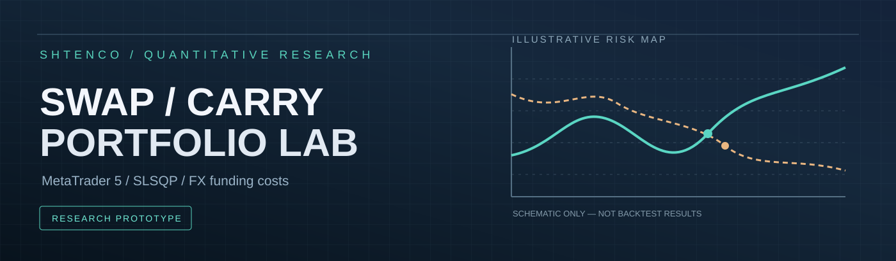
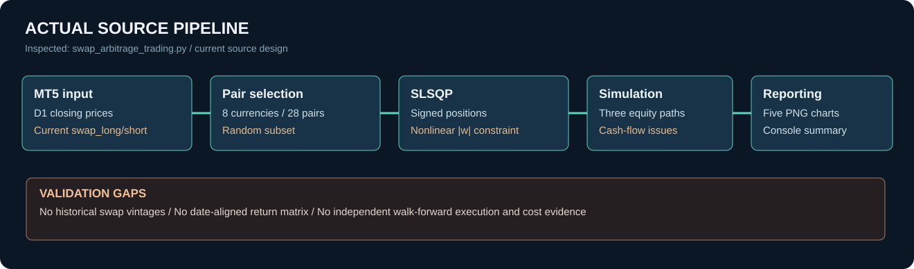
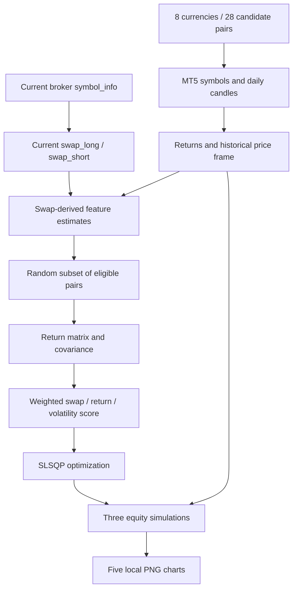
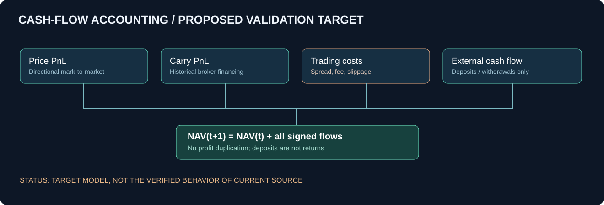
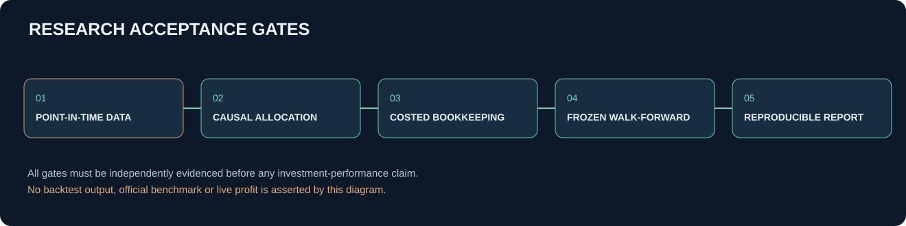

<div align="center">



**Исследовательская лаборатория валютных портфелей с учётом свопов, корреляций и рисков**

Реальные исходники MT5, методы количественной оптимизации, бухгалтерская проверка симуляции и научная программа воспроизводимости.

[Метод](#исследовательская-постановка) · [Код](#аудит-фактической-реализации) · [Математика](#математическая-модель) · [Дефекты](#критические-ограничения-текущей-реализации) · [Результаты](#достоверность-результатов) · [Запуск](#воспроизведение) · [Развитие](#план-научной-и-инженерной-доработки)

</div>

> **Статус: quantitative research prototype; не инвестиционный продукт.** В репозитории имеется код загрузки MT5, вычисления признаков carry, оптимизации SLSQP и визуализации трёх сценариев портфеля. Ни гарантированный арбитраж, ни реальная положительная доходность, ни воспроизведённый десятилетний backtest по историческим ставкам свопов этим исходником не доказаны.

## Исследовательская постановка

Валютные портфели нельзя оценивать только по изменению курсов. Позиции порождают затраты и поступления от переноса, зависящие от процентных ставок, расписания начислений, условий брокера, направления позиции, валюты расчётов и меняющихся во времени параметров финансового инструмента. **Swap / Carry Portfolio Lab** исследует, как учитывать это измерение при построении и сравнении распределений капитала.

Для исследовательских команд ценность кода — возможность изучить общий цикл: получение котировок и свойств инструментов MetaTrader 5, построение модельных доходностей, портфельная оптимизация, сценарная симуляция и визуальное представление риска. Для инвесторов, брокеров и финтех-команд потенциально полезна сама постановка задачи **net-of-funding portfolio allocation**, однако действующая модель требует исправлений до практического использования.

**Принцип:** carry может быть компонентом доходности, но не автоматически является арбитражем: неблагоприятное движение валюты может существенно превысить положительный swap, а ставки переноса меняются.

## Архитектура системы





**Это диаграмма наблюдаемого программного конвейера, а не схема доказанного прибыльного исполнения.** Точки передачи между историческими рядами и текущими брокерскими параметрами требуют особого внимания: источник исторической цены и источник сегодняшнего swap имеют разные временные семантики.

### Подтверждённые программные модули

| Участок | Функция | Фактическое назначение |
|:--|:--|:--|
| Формирование вселенной | `_generate_all_pairs`, `_get_currency_priority` | 8 валют, 28 неупорядоченных сочетаний |
| Соединение с MT5 | `initialize` | Подключение терминала и чтение счёта |
| Котировки | `_get_current_market_rates` | Bid/ask текущих инструментов, попытка переворота доступного символа |
| Данные и свопы | `_init_swap_data`, `_get_historical_data` | Смешанные исторические доходности и текущая swap-информация |
| Выбор портфеля | `_optimize_portfolio` | Случайный выбор подмножества, ковариация, SLSQP |
| Проверка сценариев | `_simulate_portfolio_performance` | Три рекурсивные кривые капитала |
| Визуализация | `_create_visualizations` | Состав, цена, swap, варианты equity |

Всё перечисленное находится в [`swap_arbitrage_trading.py`](swap_arbitrage_trading.py). Отдельного package API, автоматического тестового набора, lock-файла зависимостей, строгого OOS-реестра либо сохранённых подтверждённых рыночных результатов в просмотренном дереве нет.

## Математическая модель

### Историческая доходность

Исходный код использует дневную доходность закрытий:

\[
r_{i,t}=\frac{C_{i,t}}{C_{i,t-1}}-1.
\]

Для аналитически корректного приближения доходность направленной позиции со знаком \(d_i\in\{-1,+1\}\) и экспозицией \(q_i\geq0\) следует записывать как

\[
R_{p,t}=\sum_i q_i\left(d_i r_{i,t}+c_{i,t}^{(d_i)}-k_{i,t}\right),
\]

где \(c_{i,t}^{(d_i)}\) — исторический swap, корректно конвертированный в валюту счёта и приведённый к размеру позиции, а \(k_{i,t}\) — расходы на исполнение и финансирование. **Это эталонная формализация для следующей версии, не точное описание нынешней бухгалтерии скрипта.**

### Текущий эвристический балл

В `_optimize_portfolio` для доступных пар строится нормированная оценка:

\[
s_i=0.30\,\widetilde{swap_i}+0.60\,\widetilde{return_i}-0.10\,\widetilde{volatility_i}.
\]

Затем SLSQP минимизирует отрицательное отношение

\[
J(w)=-\frac{\sum_i s_iw_i-r_f}{\sqrt{w^\mathsf{T}\Sigma w}},
\]

с ограничением \(\sum_i|w_i|=1\), границами \(-1\leq w_i\leq1\) и неотрицательным swap-показателем на абсолютных весах.

Это **не классический Sharpe портфеля рыночных доходностей**: числитель содержит эвристически нормированные оценки без единиц рыночной доходности, тогда как знаменатель построен из ковариации псевдодоходностей. Смешение единиц должно быть исправлено прежде, чем отношение трактуется как риск-скорректированная доходность.

### Экономическая бухгалтерия



Для корректной симуляции в валюте отчётности нужна проверка инварианта

\[
NAV_{t+1}=NAV_t+PnL_{market,t}+PnL_{carry,t}-Costs_t+ExternalFlow_t.
\]

Внесённые пользователем деньги изменяют NAV, но **не являются прибылью**. Повторное зачисление уже учтённого накопленного результата в новый капитал — бухгалтерская ошибка, которую нельзя называть реинвестированием.

## Критические ограничения текущей реализации

| Приоритет | Наблюдение в коде | Последствие |
|:--|:--|:--|
| P0 | `symbol_info.swap_long/short` берутся на момент запуска и применяются к серии начиная с 2015 года | Исторический carry не соответствует действовавшим тогда тарифам |
| P0 | Для направления long/short используются `best_swap` и дополнительное изменение знака | Тариф и знак carry могут быть интерпретированы ошибочно |
| P0 | В `returns_data` доходность short уже инвертирована, а signed `weights` снова участвуют в расчётах | Неоднозначная/двойная инверсия короткого плеча в части метрик |
| P0 | При ежемесячном шаге `profit = current_capital_with_reinvestment - initial_capital`; затем положительный profit повторно добавляется к капиталу | Возможное двойное зачисление PnL |
| P0 | `initial_capital` мутирует в ходе расчётов, затем используется как база итогового процента | Итоговая доходность не сопоставима с исходными 10 000 долларов |
| P1 | Исторические серии обрезаются до одинаковой длины через `[:min_length]` | Ковариация сопоставляет строки разных календарных дат |
| P1 | Число пар и сами пары выбираются через `random.randint` и `random.sample` без seed | Недетерминированный результат и неполный поиск портфеля |
| P1 | Ограничение положительного swap учитывает `abs(weights)`, не реальные направленные тарифы | Оптимизатор может объявить допустимым экономически нежелательное направление |
| P1 | Если SLSQP не сошёлся, используются исходные веса, затем применяется порог \(0.05\) и нормализация | После изменения весов ограничения и оптимальность не проверяются повторно |
| P1 | В симуляции swap переводится в долларовый поток умножением на исходный капитал | Не учитывает контрактные размеры, валюту пункта, спецификацию брокера и динамическую экспозицию |
| P1 | Для финансовых метрик нет spread, комиссии, slippage, margin и stop-out | Риск и net PnL не оценены в реальных условиях исполнения |
| P2 | Переменные `optimization_period`, `simulation_days`, `target_volume` объявлены, но не определяют полный подтверждённый период/объём прогона | Конфигурация может создавать ложное впечатление завершённой калибровки |

Особенно важно: `_optimize_portfolio` рассчитывает параметры на всей доступной истории, а `_simulate_portfolio_performance` затем проходит по этой же истории. Это **оценка на обучающих данных**, а не независимый out-of-sample тест.

## Достоверность результатов

В историческом [`docs/README_LEGACY.md`](docs/README_LEGACY.md) перечислены численные результаты, включая Sharpe 0.95 и 1.68, конечный капитал в нескольких сценариях и проценты доходности. В текущем дереве нет связанных с этими величинами исходных MT5-выгрузок, point-in-time swap данных, manifest исполнения и независимого воспроизводимого отчёта.

**Следовательно, это исторические заявления, а не проверенные результаты данной ревизии.** Отдельно ошибочно считать увеличение конечного баланса в сценарии дополнительных депозитов инвестиционной доходностью без time-weighted return либо XIRR/IRR с учётом реальных денежных потоков.

| Критерий | Проверенный уровень |
|:--|:--|
| Исходный алгоритм Python | Доступен |
| Доступ к MT5 и оптимизатор SciPy | Присутствуют вызовы в коде |
| Сценарная симуляция и графики | Реализован код |
| Исторические свопы по датам | Не представлены |
| Честное выравнивание календарных рядов | Не реализовано корректно |
| Строгий walk-forward и sealed OOS | Нет |
| Верифицированная прибыль | Нет |
| Брокерский execution parity | Нет |

## Пять диаграмм, создаваемых программой

`_create_visualizations` сохраняет локально:

| Артефакт | Содержимое |
|:--|:--|
| `portfolio_proportions.png` | Состав портфеля с long/short-метками |
| `portfolio_returns.png` | Капитал без начисления swap |
| `portfolio_swap.png` | Накопленный модельный swap |
| `portfolio_with_swap.png` | Модельный капитал со swap |
| `portfolio_with_reinvestment.png` | Третий сценарий с дополнительными денежными потоками и некорректной логикой реинвестирования |

Эти файлы не считаются проверенными или существующими в Git до появления реальных артефактов исполнения. Диаграммы в настоящем README — **объяснительная инфографика, не исторические кривые капитала**.

## Воспроизведение

```bash
git clone https://github.com/Shtenco/swap_arbitrage_metatrader_5.git
cd swap_arbitrage_metatrader_5
python -m venv .venv
# Активировать окружение для вашей ОС.
python -m pip install MetaTrader5 pandas numpy matplotlib scipy
python swap_arbitrage_trading.py
```

Необходимы совместимый терминал MetaTrader 5, доступные в нём валютные инструменты и корректные контрактные данные. В репозитории **нет `requirements.txt`**, поэтому зависимости указаны по импортам исходника, а не по зафиксированным версиям. Runtime, реальные котировки брокера и результаты исполнения в данном аудите не воспроизводились. Использование финансируемого торгового счёта для исследования не рекомендуется.

## План научной и инженерной доработки



| Стадия | Работы | Критерий приёмки |
|:--|:--|:--|
| M0 | Выделить ingestion, optimization, accounting, reporting в тестируемые модули | Unit tests на детерминированных фикстурах |
| M1 | Привести swap в единую валюту и использовать point-in-time тарифы и календарь начислений | Broker-validated carry ledger |
| M2 | Выравнять price returns по датам, определить корректный знак позиции и ограничения | Паритетность расчётов long и short на известных примерах |
| M3 | Исправить учёт внешних потоков, депозитов, доходности и leverage | Бухгалтерские инварианты и XIRR/TWR |
| M4 | Сделать причинную оптимизацию в каждом окне с заморозкой параметров | Walk-forward без leakage и hindsight |
| M5 | Зафиксировать seed, исходные файлы, версии библиотек, хэши и конфигурацию | Manifest + проверка повторяемости |
| M6 | Добавить spread/slippage/commission/margin/stop-out стресс-тесты | Net risk-adjusted OOS metrics |
| M7 | Сравнить с equal-weight, no-carry, cash и независимыми carry baselines | Ablation с доверительными интервалами |

## Где проект может дать ценность

**Quant research:** модульная лаборатория для сравнения способов включения финансирования в валютную аллокацию.

**Risk engineering:** исследование различий между рыночным PnL и переносом позиции, влияния брокерских тарифов, корреляций и структурных разрывов режимов.

**Fintech infrastructure:** исходная база для будущего сервиса оценки portfolio financing cost, при условии разделения источников фактических данных, алгоритмов и полномочий на исполнение.

Эти направления являются **потенциальными сценариями развития**, не проданными продуктами, не созданной доходностью и не подтверждёнными интеграциями.

## Итоговое научное заключение

Здесь есть реальный исследовательский код: вселенная валютных пар, работа с MetaTrader 5, эвристическая оптимизация и симуляция состава/капитала. Но нынешняя модель **не проходит критерии воспроизводимого независимого бэктеста** из-за временной подмены ставок, несогласованности знаков, отсутствия корректного учёта депозитов и проверок после оптимизации. Инженерно перспективен не маркетинговый тезис «стабильная арбитражная прибыль», а задача построения причинно достоверной модели FX carry с прозрачной бухгалтерией, валидацией и управлением риском.

---

**SYNERGY research federation:** [SYNERGY SYSTEM](https://github.com/Shtenco/synergy_system) · [Полный исходник](swap_arbitrage_trading.py) · [Историческая документация](docs/README_LEGACY.md) · [Эталон инженерного оформления](https://github.com/Shtenco/synergy_eurasian)
